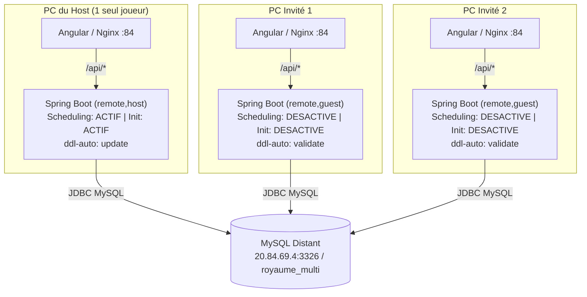

# Guide Multijoueur — Mode Host / Invité sur BDD distante

Ce guide explique comment jouer **à plusieurs en même temps**, chacun depuis sa propre machine (Windows, macOS ou Linux), sans qu'un serveur centralisé ne soit hébergé pour l'application, tout en partageant la **base de données MySQL distante** (`20.84.69.4:3326`).

---

## 1. Principe (Host vs Invité)

Pour éviter que plusieurs backends Spring Boot ne fassent tourner le moteur de jeu en même temps (ce qui doublerait la production de ressources, finaliserait les chantiers en double ou réinitialiserait la base au démarrage), l'équipe se répartit en **2 rôles** :

- **1 seul joueur = Host** (`docker-compose.host.yml`, profils Spring `remote,host`) :
  - Initialise les tables et les données de référentiel (5 peuples, 9 paliers de niveau).
  - Fait tourner les schedulers (`TickerService` toutes les 60 s, `ChantierScheduler` toutes les 1 s).
  - Utilise `ddl-auto=${HOST_DDL_AUTO:update}` par défaut pour ne pas effacer la partie en cas de redémarrage.
- **Tous les autres joueurs = Invités / Guests** (`docker-compose.guest.yml`, profils Spring `remote,guest`) :
  - Servent l'interface Angular et l'API REST en lecture/écriture sur la même base distante.
  - **Aucun scheduler** n'est actif (`royaume.scheduling.enabled=false`).
  - **Aucune initialisation ni modification de schéma** (`royaume.init.enabled=false`, `ddl-auto=validate`).



---

## 2. Branche dédiée `multi-host-guest`

Cette configuration vit sur la branche **`multi-host-guest`**, séparée de `dev` et de `main` (elle n'a pas vocation à être mergée dans `main`).

### Récupérer la branche sur son poste
```bash
git fetch origin
git checkout multi-host-guest
```

### Actualiser la branche avec les nouveautés de `dev`
Quand du nouveau code est ajouté sur `dev`, il suffit de le merger dans `multi-host-guest`, puis de relancer avec `--build` :
```bash
git checkout dev
git pull origin dev
git checkout multi-host-guest
git merge dev
```

---

## 3. Prérequis

- **Voie recommandée (Docker)** : uniquement **Docker** (Docker Desktop sur Windows/macOS, ou Docker Engine + plugin `docker compose` sur Linux).
  - Aucune installation locale de Java, Maven ou Node.js n'est nécessaire : les Dockerfiles multi-stage (`royaume_back/Dockerfile.multi` et `royaume_front/Dockerfile.multi`) compilent tout dans des conteneurs propres.
- **PC trop lent pour Docker** : voir le **[Plan B — Jouer sans Docker](#7-plan-b--jouer-sans-docker-pc-lent)**.
- **Utilisation de la VM Docker distante en SSH** : voir le **[Plan C — Utiliser le Docker distant en SSH](#8-plan-c--utiliser-le-docker-distant-en-ssh-azureuser2084694)**.

---

## 4. Configuration initiale (1 seule fois par machine)

1. À la racine du dépôt, copiez le fichier modèle `.env.multi.example` vers `.env.multi` :
   - **Windows PowerShell** :
     ```powershell
     Copy-Item .env.multi.example .env.multi
     ```
   - **Windows CMD** :
     ```cmd
     copy .env.multi.example .env.multi
     ```
   - **macOS / Linux / Git Bash** :
     ```bash
     cp .env.multi.example .env.multi
     ```
2. Ouvrez `.env.multi` et renseignez le vrai mot de passe dans `REMOTE_DB_PASSWORD` :
   ```dotenv
   REMOTE_DB_HOST=20.84.69.4
   REMOTE_DB_PORT=3326
   REMOTE_DB_NAME=royaume_multi
   REMOTE_DB_USER=root
   REMOTE_DB_PASSWORD=<MOT_DE_PASSE_DISTANT>

   HOST_DDL_AUTO=update

   MULTI_FRONT_PORT=84
   MULTI_BACK_PORT=8094
   ```
3. Vérifiez que **tout le monde a exactement le même `REMOTE_DB_NAME`** (par défaut `royaume_multi`).

> Le fichier `.env.multi` est listé dans `.gitignore` : vos identifiants ne seront jamais envoyés sur Git.

---

## 5. Lancer une partie (Windows / macOS / Linux)

Les commandes ci-dessous sont **strictement identiques** sur tous les systèmes et terminaux.

### Étape 1 — Le Host démarre EN PREMIER (1 seule personne)

```bash
docker compose --env-file .env.multi -f docker-compose.host.yml up -d --build
```

Vérifiez les logs du backend Host avant de laisser les Invités se connecter :
```bash
docker compose --env-file .env.multi -f docker-compose.host.yml logs -f java
```
Attendez de voir la bannière de démarrage ainsi que `Started RoyaumeApplication` :
```text
============================================================
ROYAUME BACKEND - MODE : HOST
Profils actifs         : remote, host
Scheduling (moteur)    : ACTIF
Init referentiel       : ACTIF
Hibernate ddl-auto     : update
Datasource URL         : jdbc:mysql://20.84.69.4:3326/royaume_multi?...
============================================================
```
*(Appuyez sur `Ctrl+C` pour quitter l'affichage des logs sans arrêter les conteneurs.)*

> **Important :** Le Host doit garder sa stack allumée pendant toute la durée de la partie pour que le moteur de jeu (`TickerService` et `ChantierScheduler`) continue de tourner.

### Étape 2 — Les Invités démarrent ENSUITE

Une fois que le Host confirme que son backend est démarré, chaque Invité lance :
```bash
docker compose --env-file .env.multi -f docker-compose.guest.yml up -d --build
```

*(Vérification optionnelle)* Dans `docker compose --env-file .env.multi -f docker-compose.guest.yml logs -f java`, vous devez voir :
```text
============================================================
ROYAUME BACKEND - MODE : INVITE (GUEST)
Profils actifs         : remote, guest
Scheduling (moteur)    : DESACTIVE
Init referentiel       : DESACTIVE
Hibernate ddl-auto     : validate
Datasource URL         : jdbc:mysql://20.84.69.4:3326/royaume_multi?...
============================================================
```

### Étape 3 — Jouer

Chaque joueur ouvre dans son navigateur local :
- **Jeu (Front Angular)** : `http://localhost:84`
- **API Spring Boot locale** : `http://localhost:8094`

1. Un joueur crée une partie depuis l'interface, les autres la rejoignent depuis le lobby.
2. Chaque joueur crée son royaume et rejoint la partie, puis la partie est démarrée.

---

## 6. Arrêter et repartir sur une nouvelle partie vierge

### Arrêter les conteneurs
- **Host** :
  ```bash
  docker compose --env-file .env.multi -f docker-compose.host.yml down
  ```
- **Invité** :
  ```bash
  docker compose --env-file .env.multi -f docker-compose.guest.yml down
  ```

### Repartir sur une base toute neuve
- **Option recommandée (la plus simple)** : tout le groupe change simplement `REMOTE_DB_NAME` dans son `.env.multi` (ex. `royaume_multi_2`), puis le Host démarre en premier et les Invités suivent.
- **Option reset sur la même base (`royaume_multi`)** :
  1. Tous les Invités arrêtent leur stack (`down`).
  2. Le Host passe temporairement `HOST_DDL_AUTO=create` dans son `.env.multi` et relance `docker compose --env-file .env.multi -f docker-compose.host.yml up -d`.
  3. Dès que `Started RoyaumeApplication` apparaît dans les logs du Host, le Host remet immédiatement `HOST_DDL_AUTO=update` dans son `.env.multi` (pour éviter tout reset au redémarrage suivant).
  4. Les Invités peuvent alors relancer leur stack `docker-compose.guest.yml`.

---

## 7. Plan B — Jouer SANS Docker (PC lent)

Si un poste n'a pas Docker, il peut lancer directement le backend et le frontend en local avec **Java 21** et **Node.js**, en utilisant exactement les mêmes profils Spring (`remote,guest` pour un Invité, ou `remote,host` pour un Host).

> **Attention à `application-local.properties` :**
> Si le fichier `royaume_back/src/main/resources/application-local.properties` existe sur votre poste et définit `spring.datasource.*` ou un autre `server.port`, renommez-le temporairement ou commentez son contenu avant de lancer le mode multijoueur (car `application.properties` l'importe automatiquement).

### 1. Lancer le backend (depuis `royaume_back/`)

Remplacez `guest` par `host` uniquement si ce poste joue le rôle de Host.

- **macOS / Linux / Git Bash** :
  ```bash
  cd royaume_back
  REMOTE_DB_NAME=royaume_multi REMOTE_DB_PASSWORD=<mot_de_passe> ./mvnw spring-boot:run -Dspring-boot.run.profiles=remote,guest
  ```
- **Windows PowerShell** :
  ```powershell
  cd royaume_back
  $env:REMOTE_DB_NAME="royaume_multi"
  $env:REMOTE_DB_PASSWORD="<mot_de_passe>"
  .\mvnw.cmd spring-boot:run "-Dspring-boot.run.profiles=remote,guest"
  ```
- **Windows CMD** :
  ```cmd
  cd royaume_back
  set REMOTE_DB_NAME=royaume_multi
  set REMOTE_DB_PASSWORD=<mot_de_passe>
  mvnw.cmd spring-boot:run -Dspring-boot.run.profiles=remote,guest
  ```

### 2. Lancer le frontend (dans un 2e terminal, depuis `royaume_front/`)

```bash
cd royaume_front
npm install
npm start
```

Ouvrez ensuite **`http://localhost:4200`** dans le navigateur (`proxy.conf.json` redirige automatiquement `/api/*` vers `http://localhost:8080`).

---

## 8. Plan C — Utiliser le Docker distant en SSH (`azureuser@20.84.69.4`)

Si un membre du groupe utilise le Docker de la machine distante (`20.84.69.4`) via sa clé SSH `.pem` :

1. **Permissions de la clé** (macOS / Linux / Git Bash) :
   ```bash
   chmod 400 chemin/vers/cle.pem
   ```
2. **Ports libres** : sur cette VM, les ports `82` / `8091` (Vierge) et `83` / `8092` (Démo) peuvent déjà être utilisés par Jenkins. Dans le `.env.multi` sur la VM, utilisez des ports disponibles, par exemple :
   ```dotenv
   MULTI_FRONT_PORT=85
   MULTI_BACK_PORT=8095
   ```
   *(Si la VM hébergeait plusieurs joueurs en même temps, chaque joueur devrait aussi passer un nom de projet Compose unique avec `-p multi-<pseudo>` et des ports distincts dans son `.env.multi`, car `container_name` est fixe dans les fichiers Compose par défaut.)*
3. **Accès sans ouvrir de port public supplémentaire (recommandé — tunnel SSH)** :
   Depuis son propre PC :
   ```bash
   ssh -i chemin/vers/cle.pem -L 8084:localhost:85 azureuser@20.84.69.4
   ```
   Puis ouvrir **`http://localhost:8084`** dans son navigateur local.
   *(Si le port `MULTI_FRONT_PORT` est ouvert dans le pare-feu Azure, l'accès direct via `http://20.84.69.4:85` fonctionne également.)*

---

## 9. Dépannage rapide

| Symptôme | Cause probable | Solution |
| --- | --- | --- |
| `Schema-validation: missing table` côté Invité | Un Invité a démarré avant le Host sur une base vide | Arrêter l'Invité, attendre que le Host affiche `Started RoyaumeApplication`, puis relancer l'Invité |
| `Renseignez REMOTE_DB_PASSWORD dans .env.multi` | Le fichier `.env.multi` n'a pas été créé ou le mot de passe est vide | Copier `.env.multi.example` vers `.env.multi` et renseigner `REMOTE_DB_PASSWORD` |
| `Access denied for user 'root'@...` | Mauvais mot de passe ou utilisateur MySQL dans `.env.multi` | Corriger `REMOTE_DB_PASSWORD` / `REMOTE_DB_USER` puis relancer `up -d` |
| `Bind for 0.0.0.0:84 failed: port is already allocated` | Le port `84` (ou `8094`) est déjà pris sur le PC | Modifier `MULTI_FRONT_PORT` / `MULTI_BACK_PORT` dans `.env.multi` et relancer `up -d` |
| Ressources qui augmentent x2 ou actions en double | Plusieurs instances tournent en mode `host` | Vérifier les logs (`logs java`) de chaque joueur : **un seul** doit afficher `MODE : HOST`, tous les autres `MODE : INVITE (GUEST)` |
| Le tout premier `--build` prend 1 à 3 minutes | Téléchargement des images Maven/Node + dépendances | Normal au premier lancement ; les builds suivants réutilisent le cache Docker |
